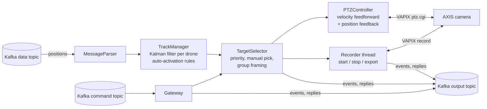

# DroneTracker

*trigonometry, kafka, and drone tracking walk into a bar*

DroneTracker points an AXIS PTZ camera (via [VAPIX](https://www.axis.com/vapix-library/)) at drones whose GPS
positions arrive over Kafka, and records them. It was built for NC State's [AERPAW](https://aerpaw.org) program.

Version 2 tracks several drones at once, uses their velocity to move the camera smoothly, and decides by itself
when to start and stop filming.

## How it works



1. **Tracking.** Each position report goes into that drone's constant-velocity Kalman filter. The filter works in
   a local east/north/up frame (metres) centred on the lens. It smooths out GPS noise, copes with packets that are
   irregular or out of order, and predicts where the drone will be when the next camera command takes effect.
2. **Deciding what to film** (`auto` mode). A drone becomes *active* once it has been fresh, airborne, in range,
   above the minimum elevation, and inside the visible sector for `auto/activate_after` seconds. It becomes inactive
   after failing those checks for `auto/deactivate_after` seconds, so brief data dropouts don't cut the recording.
3. **Choosing targets.** Precedence: a drone picked over Kafka, then `framing/priority`, then whichever activated
   first. The current target is kept unless a strictly higher-priority drone appears. Other drones are added to the
   shot while everything fits within `framing/max_group_hfov`.
4. **Moving the camera.** Every tick (`control/hz`) the controller reads the camera's real position. It then sets
   continuous pan/tilt speeds of *the target's angular rate* (feedforward from the velocity) plus *kp × pointing
   error* (feedback). Zoom is driven the same way towards the field of view the shot needs. The camera glides with
   the drone instead of jumping a few degrees at a time.
5. **Recording.** Recording starts when there is something to film and stops `recording/stop_after` seconds after
   there isn't. Each recording is exported to `recording/dir` as `session-<UTC time>.mkv`. Beside it,
   `session-<UTC time>.jsonl` logs every event (including the export finishing) and the state twice a second: which drones were in shot, where each
   one was, and where the camera pointed. Recording runs on its own threads, so a slow or failing camera never
   stalls tracking.

## Running

```sh
sudo docker compose build && sudo docker compose up -d
```

`config.yml` is mounted into the container, so after editing it run `docker compose restart`. Recordings go to
`/opt/DroneTracker/recordings` on the host. Camera credentials can come from the `DRONETRACKER_CAMERA_USERNAME` and
`DRONETRACKER_CAMERA_PASSWORD` environment variables, so they stay out of the config file.

Without Docker: `pip install -r requirements.txt && python dronetracker.py --config config.yml`.

## Messages (data topic)

```json
{"drone_id": "uav1", "t": 1729300000.12,
 "position": {"latitude": 35.7275, "longitude": -78.6959, "altitude": 120.5, "alt_ref": "msl"},
 "velocity": {"north": 3.1, "east": -0.4, "down": 0.0}}
```

| Field | |
|---|---|
| `drone_id` | Optional. If missing, the Kafka message key is used; if that's missing too, `default`. Use the key as the drone id so each drone's messages stay in order on one partition. |
| `t` | Optional measurement time, in epoch seconds or milliseconds. **Send it if you can.** It lets the tracker allow for transit delay. A timestamp is ignored, with a warning, if it is more than `ingest/max_clock_skew` seconds in the future, or more than `max_clock_skew` + 5 seconds old. |
| `alt_ref` | Optional. `msl`, or `rel` (relative to `site/ref_alt_msl`). Defaults to `ingest/default_alt_ref`. |
| `velocity` | Optional, in NED (north, east, down) m/s. The filter estimates velocity from positions anyway; reported velocity just makes it converge faster. |

v1 messages (`velocity: {x, y, z}`, no id or timestamp) are still accepted. Their axes are read according to
`ingest/legacy_velocity_frame`. If reported velocities consistently disagree with the drone's actual movement
(swapped north/east, or flipped up/down), DroneTracker logs a warning and ignores that drone's reported velocity.

## Commands (command topic)

The message key is the command and the value is its argument. Replies go to the output topic under the same key.
`utils/command.py` sends a command and prints the reply.

| Key | Value | Reply |
|---|---|---|
| `track_camera` | `off` / `on` / `auto` | `success` / `failure` |
| `select` | a drone id, or `none` to go back to automatic selection | `success` / `failure` |
| `priority` | comma-separated drone ids, most important first | `success` |
| `status` | | JSON: mode, targets, camera, tracks, session |
| `list_recordings` | | newline-separated `.mkv` and `.jsonl` files |
| `download_recording` | `<index or name> <host> [port]` | `success <index>` / `failure <index>` once the file has been streamed over TCP to host:port (port defaults to `recording/download_port`) |

The modes:
* `off`: stop filming and park the camera immediately.
* `on`: film any drone with fresh data, whether or not it passes the auto rules (useful for ground tests).
* `auto` (the default at startup): film drones that pass the auto rules.

In v1, "on" ended when packets timed out and had to be sent again. In v2 the mode stays until it's changed.

DroneTracker also publishes events under the key `event`, as JSON with a `type`:
* `mode`
* `track_active` / `track_inactive`
* `targets`
* `session_started` / `session_ended`
* `recording_started` / `recording_stopped` / `recording_exported`
* `recording_failed` / `export_failed`
* `selected` / `priority`

## Field setup and calibration

Do these in order the first time the camera is set up on a site.

1. **Position.** Set `camera/lat`, `lon` and `alt` to the lens position, with `alt` as metres above mean sea
   level.
2. **Altitude reference.** If drones report altitude relative to their takeoff point (common with MAVLink), set
   `site/ref_alt_msl` to that point's MSL altitude and `ingest/default_alt_ref: rel`. `auto/min_height` is measured
   from this reference too. A mixed-up reference shows up as tilt that's consistently too high or too low.
3. **Offset.** `camera/offset` is the camera pan that looks at true north. Point the camera at a landmark with
   known coordinates using `utils/cameracontroller.py`, press `p`, and set the offset so the printed azimuth
   matches the landmark's true bearing.
4. **Speed table.** Turn off "proportional speed" (zoom-dependent speed) in the camera's PTZ settings. Then run
   `python utils/calibrate_speed.py` and paste the tables it prints into `camera/speed`. Velocity control relies on
   knowing what each speed setting really does.
5. **Zoom table** (optional). The default assumes magnification grows linearly with zoom step. If drones end up
   framed too tight or too loose at some zoom levels, measure the horizontal FOV at a few steps and set
   `camera/zoom/table`.
6. **Rehearse offline.** Run `python utils/simulate.py`, with your config, to see how settings changes affect tracking.
   Then run `python utils/fake_drones.py pair` against the real stack before a live flight.

## Configuration

All options live in `config.yml`. Anything left out takes the default shown. Unknown options are rejected, so
typos don't fail silently.

| Option | Default | Description |
|---|---|---|
| `logs` | `info` | `debug`, `info`, `warning` or `error` |
| `camera/ip`, `username`, `password` | | Camera address and login. The login can also come from environment variables (see above). |
| `camera/simulate` | `false` | Use a simulated camera instead of real hardware |
| `camera/request_timeout` | `1.0` | Seconds before a camera HTTP request is abandoned |
| `camera/lat`, `lon` | | Lens position: decimal degrees, or Google Maps style `35°43'38.9"N` |
| `camera/alt` | | Lens altitude, metres above mean sea level |
| `camera/offset` | `0` | Camera pan that looks at true north. pan = azimuth + offset. |
| `camera/tilt_limits` | `[-90, 45]` | Mechanical tilt range |
| `camera/park/pan`, `tilt` | `null`, `-90` | Where to point when idle. Pan is an azimuth; `null` leaves that axis where it is. |
| `camera/park_after` | `10` | Seconds idle before parking |
| `camera/disk`, `stream_profile` | `SD_DISK`, `null` | Where to record, and which stream profile to use |
| `camera/zoom/wide_hfov`, `max_zoom` | `63.1`, `31` | Horizontal FOV at 1x, and the maximum optical zoom |
| `camera/zoom/table` | `null` | Measured `[[zoom_step, hfov_deg], ...]`, which overrides the two values above |
| `camera/speed/pan_max`, `tilt_max` | `60` | deg/s at speed 100, assuming a linear response |
| `camera/speed/pan_table`, `tilt_table` | `null` | Measured `[[speed, deg_per_s], ...]` from `utils/calibrate_speed.py` |
| `site/ref_alt_msl` | `null` | MSL altitude that `rel` altitudes and `auto/min_height` are measured from |
| `control/mode` | `velocity` | `velocity` (continuous moves with feedback) or `position` (absolute moves, a fallback) |
| `control/hz` | `10` | Control loop rate |
| `control/lookahead` | `0.2` | Seconds between deciding a command and the camera acting on it |
| `control/kp` | `2.0` | Pointing-error correction, in deg/s per degree of error |
| `control/deadband` | `0.2` | Pointing error (deg) below which there's no correction |
| `control/kz` | `150` | Zoom speed per unit of log FOV error |
| `control/zoom_deadband` | `0.15` | How much too wide (as a fraction) the shot may get before zooming in |
| `control/min_step` | `1.0` | Position mode only: smallest move (deg) worth sending |
| `tracking/accel_noise` | `3.0` | How hard (m/s²) drones are expected to manoeuvre |
| `tracking/pos_sigma`, `vel_sigma` | `2.0`, `0.5` | Expected GPS position (m) and velocity (m/s) error |
| `tracking/gate` | `50` | A position this far (m) from prediction restarts the drone's filter |
| `tracking/max_extrapolation` | `2.0` | Never predict more than this many seconds past the last report |
| `tracking/stale_after` | `1.5` | Seconds without data before a drone stops qualifying |
| `tracking/forget_after` | `60` | Seconds without data before a drone is forgotten |
| `auto/startup_mode` | `auto` | Mode on startup: `off`, `on` or `auto` |
| `auto/activate_after`, `deactivate_after` | `2`, `5` | Hysteresis, in seconds, for starting and stopping filming a drone |
| `auto/min_height` | `3` | Height above the reference (m) to count as airborne; `null` disables the check |
| `auto/max_range` | `2000` | Maximum slant range (m); `null` disables the check |
| `auto/min_elevation` | `-10` | Lowest elevation (deg) to film; `null` disables the check |
| `auto/sector` | `null` | `[from_az, to_az]`, clockwise: only film drones within this azimuth range |
| `framing/drone_size` | `1.0` | Drone size in metres |
| `framing/target_fraction` | `0.15` | Fraction of the frame width a lone drone should fill |
| `framing/uncertainty_k` | `2.0` | Sigmas of tracking uncertainty to add as margin |
| `framing/min_hfov` | `4.0` | Never zoom tighter than this many degrees |
| `framing/group` | `true` | Frame several drones together when they fit |
| `framing/max_group_hfov` | `40` | The widest shot (deg) allowed for a group |
| `framing/group_fill` | `0.8` | Fraction of the frame a group's spread should fill |
| `framing/aspect` | `1.778` | Frame aspect ratio |
| `framing/priority` | `[]` | Drone ids, most important first |
| `recording/enabled` | `true` | Record on the camera and export the files |
| `recording/dir` | `recordings` | Where exports and session logs go |
| `recording/stop_after` | `10` | Seconds with nothing to film before the recording stops |
| `recording/log_interval` | `0.5` | Seconds between state lines in the session log |
| `recording/download_port` | `15321` | Default port for `download_recording` |
| `kafka/servers` | | Broker addresses, as `host:port` |
| `kafka/data_topic`, `command_topic`, `output_topic` | `dronetracker-data`, `dronetracker-command`, `dronetracker-output` | Topic names |
| `ingest/default_alt_ref` | `msl` | Altitude reference for messages that don't give one |
| `ingest/legacy_velocity_frame` | `ned` | How to read v1 `{x, y, z}` velocities: `ned`, `enu`, or `v1` (x = east, y = north, z = down, which is what v1 assumed) |
| `ingest/max_clock_skew` | `2.0` | How far (s) message timestamps may differ from this machine's clock |
| `ingest/default_latency` | `0.0` | Transit time (s) assumed for messages without a timestamp |

## Utilities

| Script | Purpose |
|---|---|
| `utils/simulate.py` | Fly the built-in scenarios (orbit, flyby, overhead, pair, takeoff) against the full tracker and a simulated camera, and report how well the drones stayed in frame. `--trace out.csv` writes per-tick data. |
| `utils/fake_drones.py` | Publish simulated flights (or `--hover LAT LON ALT`) to Kafka in real time, in v2 or v1 format |
| `utils/command.py` | Send a command and print the reply, or `--watch` the output topic |
| `utils/calibrate_speed.py` | Measure the camera's real pan/tilt speeds and print `camera/speed` tables |
| `utils/cameracontroller.py` | Drive the camera from the keyboard; `p` prints the position and the azimuth it corresponds to |

## Development

```sh
pip install -r requirements-dev.txt
pytest
```

The tests cover the geometry, filtering, auto rules, targeting, control (against the simulated camera), the VAPIX
client (against canned responses), the commands, and full end-to-end simulations of every scenario.

## Changes from v1

* **Config layout changed.** `kafka/ip` became `kafka/servers`. `kafka/hz` became `control/hz`. `camera/long`
  became `camera/lon`. `camera_login/*` moved into `camera/`. `camera/lead`, `delay`, `min_step`,
  `min_zoom_step`, `zoom_error` and `maximum_zoom` and the `drone`/`scale` sections are replaced by
  `control/lookahead`, the `framing` options, and `camera/zoom`. `deactivate_pos` became `park`, and `null` now
  means "don't move this axis" (in v1, `pan: 0` actually turned the camera to face north).
* **Behaviour.** The `off` command now works (v1 compared bytes with a string, so it was ignored). `on` persists
  instead of ending at the first data gap. `auto` is implemented and is the default.
* **Downloads.** Files are streamed by DroneTracker itself instead of shelling out to netcat. That fixes the broken
  host and path handling and removes a shell-injection hole.
* **Dependencies.** `sensecam-control` is no longer used. Its 401 handler called `sys.exit`, and it had no
  timeouts or session reuse.
